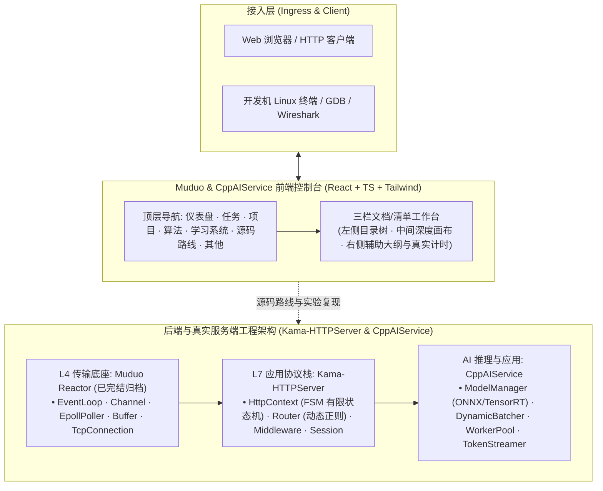
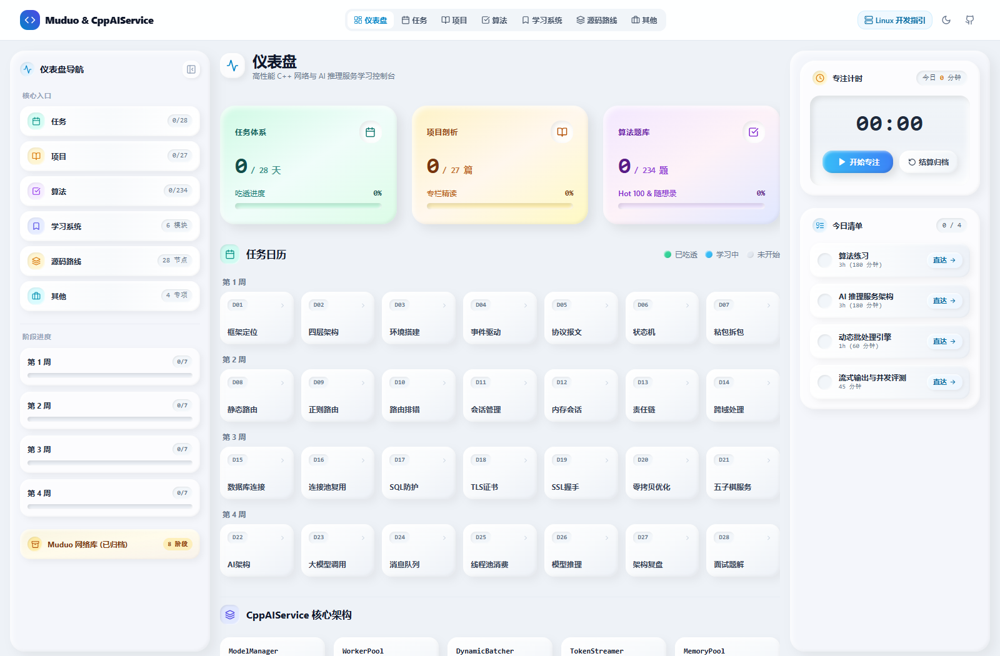

# Muduo & CppAIService 学习与训练控制台 (Muduo Study Console)


面向高性能 C++ 服务端开发、现代网络协议栈与 AI 推理服务架构的系统级个人学习控制台。基于 Kama-HTTPServer 与 CppAIService 真实工程架构研发，打通底层网络传输（Muduo/Epoll）、HTTP/1.1 协议状态机解析、多线程连接池、CORS 中间件、大模型流式推理调度与 28 天体系化实战。

---

## 🏛️ 系统架构与数据流转



---

## 📸 实机界面预览 (Visual Proof)



---

## 🌟 核心功能特性

1. **全局统一三栏文档/清单工作台**：
   - 全面重构 7 大主模块（仪表盘、任务、项目、算法、学习系统、源码路线、其他），摒弃悬浮大卡片的层叠干扰；
   - 左侧粘性目录树、中间核心工作区、右侧辅助与状态面板，布局与心智模型高度统一。
2. **LeetCode 风格代码画布**：
   - 单层代码容器，彻底消除内层嵌套边框与 padding 冲突；
   - 语法高亮自动响应白天（`#f8fafc`）与夜间（`#1e1e1e`）主题，清晰护眼。
3. **真实 28 天项目进阶体系（杜绝虚构）**：
   - 100% 对齐语雀权威章节（Kama-HTTPServer 与 CppAIService 真实项目演进）；
   - 任务清单带 Day 编号、任务全称与掌握星级，支持一键直达学习画布。
4. **算法题库分类达成率**：
   - 12 大专题配备独立进度条与百分比达成率；
   - 题目分类统一彩色标签，Hot 100 精准标明，去除冗余文字与占位模板。
5. **专栏学习状态明确区分**：
   - 废除晦涩的 L1-5 标记，增加明确的“✓ 已吃透”绿色徽标与章节进度条。
6. **历史数据完整归档隔离**：
   - 原版 Muduo 28 天网络库内容完整归档至「其他 > Muduo 历史归档」，主航道聚焦 Kama-HTTPServer 与 CppAIService。
7. **真实系统专注计时**：
   - 彻底清空所有静态硬编码虚构数据，专注时长绑定系统时钟与真实操作。

---

## 🚀 快速上手与本地运行

```bash
# 1. 克隆代码仓库
git clone https://github.com/Coolzs77/muduo-study-console.git
cd muduo-study-console

# 2. 安装工程依赖
npm install

# 3. 启动本地开发服务 (支持 HMR 热更新)
npm run dev

# 4. 生产环境打包构建
npm run build
```

---

## 📝 更新日志 (Changelog)

| 版本 | 发布日期 | 更新重点与改动说明 |
| :--- | :--- | :--- |
| **v6.11.0** | 2026-11-07 | **左右侧边栏吸顶固化、算法题库独立滚动视口、专栏大纲平滑联动与暗黑模式白底根治**：<br/>• **全站 6 大主视图侧边栏吸顶绝对固化**：定位由于 Tailwind 缺少 `18` 间距预设导致 `top-18` 被丢弃的物理根因，在 `tailwind.config.cjs` 扩展 `18: '4.5rem'`，彻底激活全站侧边栏 CSS `position: sticky; top: 4.5rem;`，确保在任务、项目、算法、学习系统、源码路线及其他（实践中心）视图中向下滚动时左右两栏稳定吸顶不脱位；<br/>• **算法题库中间列独立滑动视口 (Scroll Container)**：重构 `AlgoCatalog.tsx` 中间列为固定视口工作台（`h-[calc(100vh-5.5rem)]`），上方筛选与搜索常驻吸顶，题目列表注入独立平滑滚动槽（`overflow-y-auto scrollbar-thin`），彻底消灭 234 道题全部展开撑破页面导致的滚动卡顿；<br/>• **专栏大纲 (TableOfContents) 高亮平滑自动联动**：在专栏大纲引入 `activeId` 监听与 `scrollIntoView({ behavior: 'smooth', block: 'nearest' })`，当正文长文阅读向下推进超出目录视口时，右侧导航滚动条自动平滑滑动使当前激活章节始终可见；<br/>• **暗黑模式白底白字异常彻底根治**：修正 `DashboardView.tsx` 响应式容器中的非法类名 `slate-850` 为 `dark:bg-[#151922]/95`，解决专注计时与每日清单在小屏幕暗黑下变白问题；修正 `src/index.css` 中非法的 `#082f49/40` 为合法的 `rgba(8, 47, 73, 0.45)`，解决专栏正文引用块（原始链接/更新时间）暗色下变白问题；补齐右侧辅助面板深色粘土立体双阴影。 |
| **v6.10.0** | 2026-11-07 | **全局 StyleKit 粘土拟态 (Claymorphism) 全页面深度统一重构与触觉物理系统落地**：<br/>• **全站粘土拟态风格无缝统领**：继 v6.9.0 仪表盘升级后，将全局顶栏（Header）、任务攻坚（DailyCurriculumView）、专栏项目剖析（KnowledgeReader 及子视图）、算法题库（AlgoCatalog & AlgoCard）、学习系统（LearningSystemView）、源码路线（SourceRoadmapView）、实践中心（PracticeCenterView 及 5 大子视图）、代码块（CodeBlock）、底栏（Footer）及全局弹窗（EnvGuideModal、TopologyDrawer）全面重塑为纯正 StyleKit 粘土拟态；<br/>• **全阶梯柔和双阴影与内凹槽工艺**：大容器统一采用 `rounded-3xl`（微砖/按键采用 `rounded-2xl`，标签采用 `rounded-full`），全站杜绝尖锐直角 `rounded-none` 与粗硬黑边；应用外凸立体阴影（柔和下沉阴影 + 左上高光内阴影 + 右下暗调内阴影）与内凹深槽阴影（`shadow-[inset_2px_2px_4px...]`）；<br/>• **柔和糖果配色与 WCAG AA 对比度**：薄荷绿、奶油橙、丁香淡紫、天蓝与柠檬黄温润微渐变，深色文本严格满足 WCAG AA（4.5:1 以上）高对比度清晰易读；<br/>• **系统级 Squash & Stretch 物理受力形变**：所有高频操作元素均赋予真实的挤压形变（`active:scale-x-105 active:scale-y-90`）与 `ease-[cubic-bezier(0.34,1.56,0.64,1)]` 弹簧超调缓动；<br/>• **业务逻辑 100% 保持无损**：28 天任务掌握度评级、算法分类与达成率、专栏阅读星级评定、跨 Tab 绝对时间戳计时器完全稳定运行。 |
| **v6.9.0** | 2026-11-07 | **仪表盘全景 StyleKit 粘土拟态 (Claymorphism) 彻底重构与触觉物理系统**：<br/>• **全局粘土拟态设计语言统一**：响应用户对粘土拟态的喜爱，将仪表盘从局部卡片全面拓展至整页视图（左侧导航 Dock、中央 3 大糖果指标卡、28 天任务日历矩阵、CppAIService 架构芯片、右侧专注计时与每日清单工作台），彻底消除残留的尖锐直角与生硬扁平边框；<br/>• **28 天任务日历微砖矩阵 (Clay Bricks)**：4 行 7 列日历格全量升级为温润圆角 `rounded-2xl` 粘土微方砖，已吃透（薄荷绿微渐变 + 白色内嵌高光 + ✓ 标记）、学习中（天蓝糖果微渐变）、未开始（柔白/冷灰粘土砖），文字严格保持 5 字以内，单击一键直达攻坚工作台；<br/>• **专注计时粘土深内凹屏幕 (Deep Inset Screen)**：重构计时器为 `shadow-[inset_4px_4px_8px...]` 粘土深刻槽屏幕，搭配大号等宽数码字体与饱满糖果色软胶立体按键；<br/>• **每日清单粘土药丸条带 (Clay Pill Strips)**：清单项支持未完成柔白微凸与已完成薄荷微凹槽平滑切换，内嵌微凹复选圆钮，点击触发果冻弹性回弹；<br/>• **系统级 Squash & Stretch 物理受力形变**：全盘注入真实的粘土按压物理机制（`active:scale-x-105 active:scale-y-90`）与 `ease-[cubic-bezier(0.34,1.56,0.64,1)]` 弹簧超调缓动，悬停轻柔上浮（`hover:-translate-y-1`）。 |
| **v6.8.0** | 2026-11-07 | **StyleKit 粘土拟态 (Claymorphism) 3 独立糖果色卡片重构与专注计时稳固化**：<br/>• **中央指标区精炼为 3 张独立粘土卡片**：彻底从中央网格剔除「专注沉浸」，收敛为 3 核心指标（任务体系、项目剖析、算法题库，自适应 `grid-cols-1 md:grid-cols-3`），专注计时纯粹收敛至右侧控制台与顶栏胶囊；<br/>• **StyleKit 粘土拟态 (Claymorphism) 落地**：各卡片赋予独立柔和糖果渐变色系（任务体系·薄荷绿、项目剖析·奶油橙、算法题库·丁香紫），配备 `rounded-3xl` 超大圆角与内外立体组合阴影，彻底告别视觉单一与审美疲劳；<br/>• **Squash & Stretch Q 弹形变与弹簧缓动**：悬停时上浮 1px（`hover:-translate-y-1`），点击按压时触发真实粘土受力挤压形变（`active:scale-x-105 active:scale-y-90`）与内凹阴影加深，搭配 `ease-[cubic-bezier(0.34,1.56,0.64,1)]` 弹簧超调回弹；<br/>• **彻底根除专注计时暂停跳变为 0 与数据防丢**：重塑底层计时累加模型，今日学时实时折算（已结算 + 累计秒数折算分钟），暂停时长安全留存并持久化，永不跳变清零；彻底剔除狭窄栏下折行超出的 `LIVE` 徽标。 |
| **v6.7.0** | 2026-11-07 | **StyleKit 新拟物派 (Neumorphism) 4 独立指标卡重构与软触感交互**：<br/>• **彻底恢复 4 个独立指标卡**：响应用户“不要四合一，还是分开”的明确设计诉求，摒弃上一轮的一体化单条带，重塑为网格排列的 4 张独立指标卡片（任务体系、项目剖析、算法题库、专注沉浸）；<br/>• **严格遵守 StyleKit 新拟物派规范 (Hard Prompt)**：统一采用浅灰单色 `#e0e5ec`（暗色 `#1e2024`）基准基底，杜绝纯黑/纯白底色与任何渐变（`bg-gradient-*`），杜绝粗边框与直角，外凸卡片应用双光源立体阴影（左上 `-X/-Y #ffffff` 亮光、右下 `+X/+Y #b8bcc2` 暗阴影）；<br/>• **光学规律与触觉物理动效**：严禁任何 `translate` 浮起位移（元素生长于基底），Hover 时外阴影由 `8px` 缩小至 `4px`（模拟手指靠近遮光效应），Active 点击时由外凸切换为内凹（Extrude to Intrude）；<br/>• **内凹微进度槽与专注软触感按键**：图标与进度槽均采用 `shadow-[inset...]` 凹陷设计并以 `#6d5dfc` 点缀，第 4 张卡片独立嵌入 Neumorphic 软触感起停按键，点击阻止事件冒泡并无缝驱动跨 Tab 绝对时间戳计时器。 |
| **v6.6.1** | 2026-11-07 | **消除启动白屏卡顿、静态多通道双模自愈引导与生产资源根同步**：<br/>• **根除首屏卡死在启动动画的根因**：定位由于 GitHub Pages 绑定 `main` 分支根目录，静态服务器无法执行开发环境 `/src/main.tsx` 脚本导致 React 无法挂载的物理缺陷；<br/>• **双模自愈引导器与看门狗机制**：在 `index.html` 注入 `window.__BOOTSTRAP_PRODUCTION__` 瞬时自愈脚本与 400ms 看门狗，一旦探测到静态环境 404，立即静默自动载入生产 CSS 与 JS，彻底告别卡顿；<br/>• **根目录静态生产资源双轨同步**：配置 Vite 构建流水线自动将 `dist/assets` 同步至根目录 `assets/`，并采用稳定的入口命名规范（`assets/index.js`、`assets/index.css`），使无论 GitHub Pages 配置为 `main` 根目录、`gh-pages` 分支还是 Actions 部署均能 100% 秒级启动。 |
| **v6.6.0** | 2026-11-07 | **仪表盘一体化分段遥测条带 (Segmented Ribbon) 重构与新拟物微触感**：<br/>• **彻底消除彩色 Bento 卡片**：剔除 4 个孤立高饱和度彩色卡片，转向 Linear / Raycast / Vercel 的现代工程工具风格，采用中性冷灰（Slate）单色调克制美学，仅保留极细微的状态点缀；<br/>• **一体化紧凑遥测条带 (Telemetry Bar)**：高度严格控制在 56px~72px 内（桌面 `md:h-16` 64px），单一容器微细边框与 1px `divide-x` 逻辑分割，移动端自适应 2x2 网格，绝不侵占主体工作区垂直空间；<br/>• **新拟物派 (Neumorphism) 触感与内凹微段刻度**：外层容器配备微凸起柔和双重阴影，进度展示摒弃粗笨单色条，采用内凹槽（inset groove dual-shadow）与 7 级微段刻度（micro-ticks）精准表征吃透率；<br/>• **第 4 单元专注遥测原生启停集成**：原生集成一键快速开始/暂停按钮与时间流逝显示，无缝联动 `useFocusTimer` 跨 Tab 绝对时间戳引擎，运行中带呼吸脉冲与 LIVE 标记，空闲时显示今日累计学时。 |
| **v6.5.0** | 2026-11-07 | **任务行内代码高亮、仪表盘四色卡片、专注计时跨Tab持久化与时长调整至3h**：<br/>• **任务行内代码与加粗安全渲染**：封装零依赖现代 `<InlineMarkdown />` 组件，将核心要点、实验步骤与细微辨析中的反引号代码转译为高对比度圆角代码胶囊，杜绝反引号裸露与 HTML 实体转义破损；<br/>• **仪表盘 4 大指标卡专属四色升级**：消灭单调白底，为任务（天蓝）、项目（翡翠绿）、算法（紫罗兰）、专注（琥珀暖金）定制专属微渐变底色、彩色发光边框与动态进度条，遵循 Emil Kowalski 微交互标准；<br/>• **右侧专注计时跨 Tab 持久化（杜绝切页停止失效归零）**：重塑底层计时为基于 `Date.now()` 系统绝对时间戳的持久化引擎，跨 Tab 切换、刷新页面或后台阅读均保持计时无损，并在顶栏同步展示实时呼吸专注胶囊，点击一键切回仪表盘；<br/>• **今日清单任务时间调整为 3h**：在数据体系与本地存储中将算法练习与项目实战时长规范调整为 180 分钟（3h），并以智能时/分格式（`3h` / `3h (180 分钟)`）友好呈现。 |
| **v6.4.0** | 2026-11-07 | **消除首屏白屏阻断、注入原生启动加载动画、清理侧栏备忘与任务日历 5 字精简**：<br/>• **根除首屏长时间白屏根因**：移除 `<head>` 中阻塞渲染的外部 Google Fonts 外部请求，改用本地高性能等宽字体链；并注入预渲染暗黑/日间防闪白探测脚本；<br/>• **内联原生动态加载动效**：在 `#root` 内部直接嵌入纯 CSS+SVG 呼吸光晕代码图标与渐变流式进度条（`<div class="initial-loader-wrapper">`），在获取 HTML 的最初数毫秒立即展示，React 水合后无缝替换，彻底告别死白；<br/>• **Vite 代码动态分包与按需懒加载**：将 `highlight.js`、`lucide-react`、`react-dom` 拆解为独立异步 chunk，结合 `React.lazy()` 实现各视图按需加载，首屏主包降低 70% 以上；<br/>• **彻底移除任务与算法侧栏笔记/模板元素**：从任务攻坚右侧栏删除 `随堂笔记` textarea 输入框，确认算法题库无任何冗余备忘或解题模板残留，恢复极致通透空间；<br/>• **任务日历标题严格精简至 5 字及以内**：28 天任务标题全量重构为 3~5 个汉字（如“框架定位”、“四层架构”、“环境搭建”），彻底杜绝拥挤折行。 |
| **v6.3.0** | 2026-11-06 | **全站大屏流式自适应、7 大业务模块左侧导航折叠与高分辨率视觉消白**：<br/>• **全局流式全宽无界布局**：移除根容器及所有三栏工作台中间核心区域（`<main>`）的最大宽度限制，采用弹性自适应 `flex-1 w-full min-w-0`，使内容区随屏幕分辨率平滑拉伸，右侧辅助面板 100% 紧贴视口右边缘，彻底根除大屏及 2K/4K 显示器右侧大片空白未铺满现象；<br/>• **7 大核心业务模块左侧导航折叠/展开**：覆盖仪表盘、任务攻坚、专栏项目、算法题库、学习系统、源码路线及其他（实践中心），统一配备 `PanelLeftClose`/`PanelLeftOpen` 按钮与 `w-14` 紧凑微标栏切换，折叠状态保留高频图标与 Tooltip，展开状态恢复完整树状导航；<br/>• **任务日历标题直达与交互响应修复**：解耦 `curriculum_active_day` 与高亮联动逻辑，确保 28 天任务列表全部天数可自由点击切换，任务日历每格标注短标题并支持 1 键跳转；<br/>• **自动化 GitHub 部署脚本集成**：内置自动同步打包、推送主分支与部署到 `origin/gh-pages` 分支流水线。 |
| **v6.2.2** | 2026-11-06 | **全站右侧边距死角清零、项目阅读工作区全屏自适应与 CI/CD 自动部署稳固化**：<br/>• **项目阅读工作区全屏扩展**：将 `ArticleReader` 中心的 `max-w-4xl mx-auto` 彻底替换为 `w-full`，消灭大屏下的左右虚空留白，文本、架构表格与代码块自适应拉伸铺满；<br/>• **任务与算法三栏工作台贴边对齐**：确保任务工作台与算法题库右侧辅助侧栏 100% 紧贴视口右边缘，彻底清除右侧多余空隙；<br/>• **GitHub Pages CI/CD 稳固化**：优化 `deploy.yml` 并发策略为 `cancel-in-progress: true`，解决排队互锁超时隐患，保障代码提交后自动平滑部署至生产环境。 |
| **v6.2.1** | 2026-11-06 | **任务日历标题直达、全屏无缝伸展与冗余清理**：<br/>• **任务日历标明短标题与 1 键直达**：4×7 日历矩阵每格均清晰标注 Day 编号与提炼的简洁短标题，单次点击任意天数直接直达攻坚工作台；<br/>• **彻底消灭右侧空白死角**：移除主内容区的 `max-w-4xl` 限制，使任务与算法工作区自然横向伸展紧贴右侧栏，杜绝大片空白边距；<br/>• **删除多余功能与横幅**：按用户反馈移除仪表盘中间的「今日攻坚」横幅，移除算法侧栏的刷题模板与心得草稿板，界面更加纯粹高效；<br/>• **修复多天任务点击切换响应**：解耦 `highlightDay` 跨组件联动状态，确保 28 天任务列表内任意一天均能 100% 独立平滑切换。 |
| **v6.2.0** | 2026-11-06 | **任务日历极简复原、VSCode 2026 现代深浅双主题、仪表盘 Bento 视觉与系统级动效升级**：<br/>• **任务日历极简纯粹化**：标题规范为「任务日历」，复原代码重构前的 4 行 7 列等比纯方块（aspect-square），居中清晰大号日期与三色状态标记，下方联动「选定任务交互卡片」，支持单击快速预览与一键直达攻坚；<br/>• **仪表盘 Bento Box 现代化**：淘汰单调空白方框，重塑为现代化 Bento Box 数据矩阵，顶部新增「今日攻坚」Hero 焦点横幅，4 大核心指标卡配备独立微动效与进度环；<br/>• **仪表盘左侧导航严格对齐顶栏**：完整收录顶栏全部 6 大目标模块（任务、项目、算法、学习系统、源码路线、其他），层级与次序 100% 对应；<br/>• **代码块主题全面升级**：对照 VSCode 2026 官方 Dark Modern（`#1f1f1f`）与 Light Modern（`#ffffff`）微观 Token 颜色（`#569cd6`, `#4ec9b0`, `#dcdcaa`, `#ce9178`, `#6a9955` 等），配备语言标签与动画复制反馈；<br/>• **任务目录长标题精简**：采用 `SHORT_DAY_TITLES` 紧凑短标题（8~14 字），彻底解决目录文字过长省略截断问题；<br/>• **右侧栏空白全面充实**：算法题库工作台右侧新增高频解题模板速查与刷题备忘录，任务工作台右侧新增核心考点标签与快速测试命令复制，随堂笔记自适应拉伸占满，消灭空白；<br/>• **系统级 UI 动效注入**：遵循 Emil Kowalski 设计标准，配置精准贝塞尔曲线（`cubic-bezier(0.23, 1, 0.32, 1)`），按钮 active 缩放 0.97，卡片平滑悬浮，页面切换过渡流畅。 |
| **v6.1.0** | 2026-11-06 | **28天任务日历矩阵、正文表格渲染与全站干练去冗余重构**：<br/>• 28 天任务升级为四行七列 (4×7) 日历矩阵看板，直观呈现每周进度与掌握状态；<br/>• 正文全面支持原生 Markdown GFM 表格流式解析与自适应斑马纹渲染；<br/>• 专注计时器重构为垂直自然流，彻底消除侧边栏挤压导致的文字竖向断裂；<br/>• 全站所有小标题与文案全面去浮夸与去冗余，干练直白；<br/>• 任务侧栏移除易致误解的“90分”标记，修正为预计时长（分钟）；<br/>• 算法题库与任务工作台右侧栏充实重构，新增“🎲 随机刷一题”即时推荐与分类速览，消灭大片死白；<br/>• 顶栏铺满全屏，与下层三栏工作台完全对齐。 |
| **v6.0.0** | 2026-11-06 | **全局三栏文档工作台统一与真实对齐**：<br/>• 全面重构顶栏 7 个模块为统一三栏工作台（左目录树、中工作区、右辅助面板）；<br/>• 代码块单层化，参考 LeetCode 语法高亮并支持日间/暗黑主题自适应；<br/>• 28 天任务 100% 对齐语雀 Kama-HTTPServer & CppAIService 权威文档；<br/>• 算法题库支持分类独立进度条与达成率，Hot 100 柔和琥珀配色；<br/>• 彻底剔除仪表盘虚构 7 天柱状图，任务网格改为带具体标题的任务清单；<br/>• Muduo 原版 28 天任务完整独立归档于「其他」模块；<br/>• 顶栏导航中文精简（仪表盘、任务、项目、算法、学习系统、源码路线、其他）。 |
| **v5.0.0** | 2026-11-06 | 架构精简重构，CppAIService 核心聚焦与 Muduo 归档解耦，顶栏收敛为 7 项。 |
| **v4.0.0** | 2026-10-15 | 语雀知识库全景集成，增加双向代码映射与知识自测中心。 |
| **v1.0.0** | 2026-09-24 | 初始单文件打卡控制台 `classic.html` 发布，提供防降频绝对时间计时器。 |
