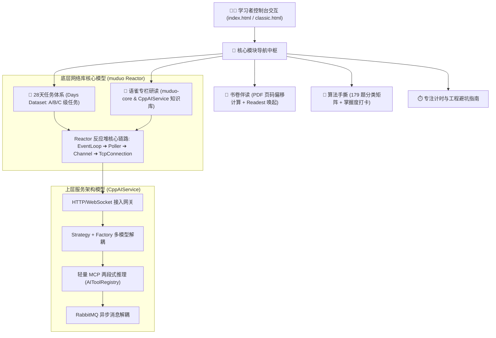

# C++ 与算法平台 (C++ & Algorithm Console)

[](#-更新日志-changelog)
[](https://nodejs.org/)
[](https://tailwindcss.com/)
[](https://coolzs77.github.io/muduo-study-console/)
[](LICENSE)

> 个人 C++ 网络编程与高并发架构专项训练控制台。系统性整合 muduo (C++11) Reactor 网络库底层机制与 CppAIService (C++17) 现代 AI 服务架构，提供章节伴读、架构拓扑映射、避坑指南、专注计时、179 道核心算法手撕矩阵与语雀权威专栏内嵌研读。

---

## 🌟 核心功能特性

- **双模部署与无依赖单文件运行**：
  - **工程化构建版本**：基于 Node.js + Tailwind CSS，支持模块化组件开发与自动化打包；
  - **离线便携版本**：内置 [`classic.html`](./classic.html)，7500+ 行原生 HTML/CSS/JS 闭环封装，直接双击即可离线全功能运行。
- **Reactor 网络库机制与架构拓扑映射**：
  - 提供交互式 SVG 拓扑流程图，清晰呈现 `EventLoop`、`Channel`、`EpollPoller`、`TcpConnection`、`Buffer` 的调用流程与线程归属（one loop per thread）；
  - 直观映射上层 CppAIService 业务链路（动态 HTTP 网关、线程池、多模型策略、两段式工具调用与异步消息队列）。
- **书卷伴读与权威教材物理页码对齐**：
  - 深度关联 `e:/workspace/C++_learning/` 下的经典书目；
  - 支持点击章节直达对应教材 PDF 印刷页码（陈硕《Linux 多线程服务端编程》偏移量 +23 页，《C++ Primer Plus（第6版）》偏移量 +30 页）；
  - 支持生成 `readest://` 本地协议锚点，一键唤起 Readest 电子书阅读器。
- **语雀专栏核心知识库原生内嵌**：
  - 抽取并收录《网络库 muduo-core》核心章节与代码实现，修复内联代码块排版，支持在控制台内免翻墙直接对照学习。
- **代码随想录 179 道算法手撕分类全览图**：
  - 按照数组、链表、哈希表、字符串、双指针、栈与队列、二叉树、回溯、贪心、动态规划、图论等分类系统排布；
  - 支持掌握度（未学习/了解/熟练/盲写）打卡记录与进度条双向联动。
- **专注计时与避坑指南**：
  - 倒计时与正向计时器，按代码编写、文档研读与调试排错分类统计学习时长；
  - 收录 SIGPIPE 忽略处理、shared_from_this 跨线程生命周期管理、Epoll LT 与 ET 模式等高频工程陷阱备忘。

---

## 📐 系统整体拓扑图



---

## 🚀 本地运行与开发

### 1. 方式一：直接运行单文件版本（推荐，无需任何环境）
进入项目根目录，直接使用浏览器双击打开：
👉 **[`classic.html`](./classic.html)**

### 2. 方式二：Node.js 工程化开发
```bash
# 1. 安装依赖
npm install

# 2. 启动本地热重载开发服务器
npm run dev

# 3. 生产环境构建打包
npm run build
```

---

## 📁 目录结构说明

```text
e:\workspace\muduo-study-console\
├── classic.html                    # 独立自包含单文件离线学习控制台 (7500+ 行原生代码)
├── index.html                      # 现代模块化 Web 主入口
├── package.json                    # Node.js 构建配置与依赖清单
├── tailwind.config.cjs             # Tailwind CSS 样式系统配置
├── V5.1_INFORMATION_ARCHITECTURE.md# V5.1 信息架构精简与功能收敛报告
├── LANGUAGE_CLEANUP_REPORT.md      # 全项目文案降 AI 腔与去浮夸审查报告
├── DEV_JOURNAL.md                  # 全生命周期研发演进实录与踩坑记录
└── README.md                       # 项目使用说明文档
```

---

## 📝 更新日志 (Changelog)

| 版本号 | 发布日期 | 更新重点与演进内容 |
| :--- | :--- | :--- |
| **v6.0** | `2026-11-05` | **平台极简化与题库升级**：主标题定为《C++ 与算法》，彻底删除所有副标题与修饰词；每日任务纯化为算法、项目、Agent、牛客 4 项；题库融合 LeetCode Hot 100 并以题号唯一去重至 204 题；生产环境完成静态 Tailwind 编译与资源同步。 |
| **v5.1** | `2026-10-06` | **架构收敛与文风重构**：剥离求职日历与冗余待办；手撕题库规范为 179 道分类全览图；语雀专栏内联代码格式深度修复；全站文案全面去浮夸与降 AI 腔；补充 Mermaid 架构拓扑。 |
| **v5.0** | `2026-10-03` | **系统级大版本重构**：全面接入 CppAIService 服务架构知识库；上线书卷伴读 PDF 自动偏移跳转；增加 Reactor 核心 SVG 拓扑映射与专注计时模块。 |
| **v4.0** | `2026-09-25` | **学习打卡系统成型**：支持 28 天 A/B/C 级阶梯任务打卡与本地掌握度数据持久化保存。 |
| **v1.0** | `2026-09-18` | **初始原型发布**：实现单页 HTML 的基础 Muduo 知识点备忘与简易打卡界面。 |

---

## 📄 开源许可证

本项目基于 MIT 许可证开源。仅供个人技术研究、C++ 底层网络库源码学习与工程实践复盘使用。
