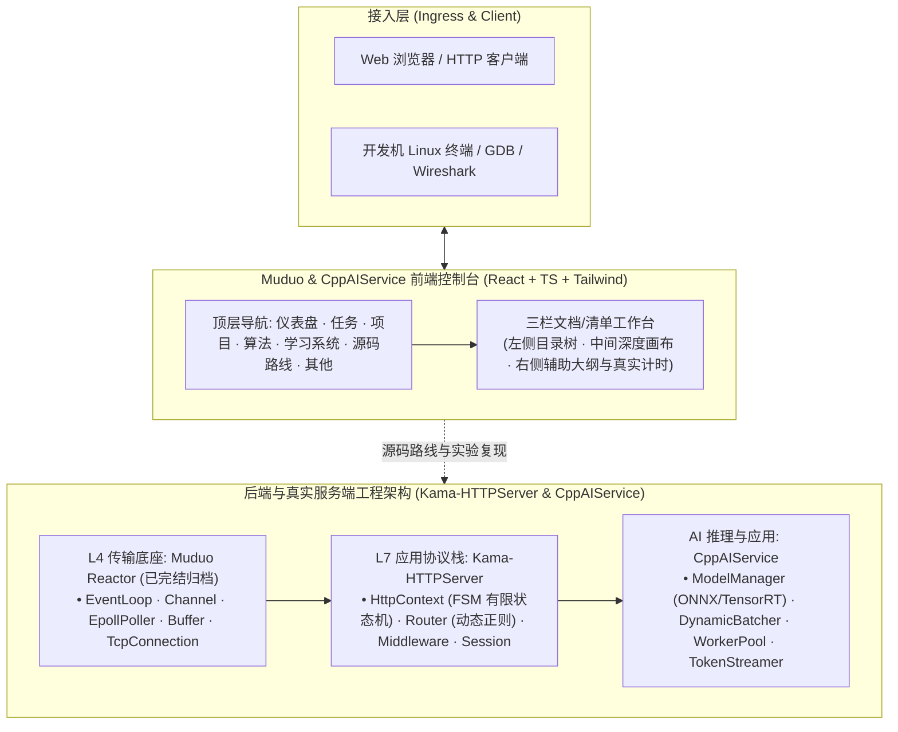

# Muduo & CppAIService 学习与训练控制台 (Muduo Study Console)


面向高性能 C++ 服务端开发、现代网络协议栈与 AI 推理服务架构的系统级个人学习控制台。基于 Kama-HTTPServer 与 CppAIService 真实工程架构研发，打通底层网络传输（Muduo/Epoll）、HTTP/1.1 协议状态机解析、多线程连接池、CORS 中间件、大模型流式推理调度与 28 天体系化实战。

---

## 🏛️ 系统架构与数据流转



---

## 🌟 核心功能特性

1. **全局统一三栏文档/清单工作台**：
   - 全面重构 7 大主模块（仪表盘、任务、项目、算法、学习系统、源码路线、其他），摒弃悬浮大卡片的层叠干扰；
   - 左侧粘性目录树、中间核心工作区、右侧辅助与状态面板，布局与心智模型高度统一。
2. **LeetCode 风格代码画布**：
   - 单层代码容器，彻底消除内层嵌套边框与 padding 冲突；
   - 语法高亮自动响应白天（`#f8fafc`）与夜间（`#1e1e1e`）主题，清晰护眼。
3. **真实 28 天项目进阶体系（杜绝虚构）**：
   - 100% 对齐语雀权威章节（Kama-HTTPServer 与 CppAIService 真实项目演进）；
   - 任务清单带 Day 编号、任务全称与掌握星级，支持一键直达学习画布。
4. **算法题库分类达成率**：
   - 12 大专题配备独立进度条与百分比达成率；
   - 题目分类统一彩色标签，Hot 100 精准标明，去除冗余文字与占位模板。
5. **专栏学习状态明确区分**：
   - 废除晦涩的 L1-5 标记，增加明确的“✓ 已吃透”绿色徽标与章节进度条。
6. **历史数据完整归档隔离**：
   - 原版 Muduo 28 天网络库内容完整归档至「其他 > Muduo 历史归档」，主航道聚焦 Kama-HTTPServer 与 CppAIService。
7. **真实系统专注计时**：
   - 彻底清空所有静态硬编码虚构数据，专注时长绑定系统时钟与真实操作。

---

## 🚀 快速上手与本地运行

```bash
# 1. 克隆代码仓库
git clone https://github.com/Coolzs77/muduo-study-console.git
cd muduo-study-console

# 2. 安装工程依赖
npm install

# 3. 启动本地开发服务 (支持 HMR 热更新)
npm run dev

# 4. 生产环境打包构建
npm run build
```

---

## 📝 更新日志 (Changelog)

| 版本 | 发布日期 | 更新重点与改动说明 |
| :--- | :--- | :--- |
| **v6.2.0** | 2026-11-06 | **任务日历极简复原、VSCode 2026 现代深浅双主题、仪表盘 Bento 视觉与系统级动效升级**：<br/>• **任务日历极简纯粹化**：标题规范为「任务日历」，复原代码重构前的 4 行 7 列等比纯方块（aspect-square），居中清晰大号日期与三色状态标记，下方联动「选定任务交互卡片」，支持单击快速预览与一键直达攻坚；<br/>• **仪表盘 Bento Box 现代化**：淘汰单调空白方框，重塑为现代化 Bento Box 数据矩阵，顶部新增「今日攻坚」Hero 焦点横幅，4 大核心指标卡配备独立微动效与进度环；<br/>• **仪表盘左侧导航严格对齐顶栏**：完整收录顶栏全部 6 大目标模块（任务、项目、算法、学习系统、源码路线、其他），层级与次序 100% 对应；<br/>• **代码块主题全面升级**：对照 VSCode 2026 官方 Dark Modern（`#1f1f1f`）与 Light Modern（`#ffffff`）微观 Token 颜色（`#569cd6`, `#4ec9b0`, `#dcdcaa`, `#ce9178`, `#6a9955` 等），配备语言标签与动画复制反馈；<br/>• **任务目录长标题精简**：采用 `SHORT_DAY_TITLES` 紧凑短标题（8~14 字），彻底解决目录文字过长省略截断问题；<br/>• **右侧栏空白全面充实**：算法题库工作台右侧新增高频解题模板速查与刷题备忘录，任务工作台右侧新增核心考点标签与快速测试命令复制，随堂笔记自适应拉伸占满，消灭空白；<br/>• **系统级 UI 动效注入**：遵循 Emil Kowalski 设计标准，配置精准贝塞尔曲线（`cubic-bezier(0.23, 1, 0.32, 1)`），按钮 active 缩放 0.97，卡片平滑悬浮，页面切换过渡流畅。 |
| **v6.1.0** | 2026-11-06 | **28天任务日历矩阵、正文表格渲染与全站干练去冗余重构**：<br/>• 28 天任务升级为四行七列 (4×7) 日历矩阵看板，直观呈现每周进度与掌握状态；<br/>• 正文全面支持原生 Markdown GFM 表格流式解析与自适应斑马纹渲染；<br/>• 专注计时器重构为垂直自然流，彻底消除侧边栏挤压导致的文字竖向断裂；<br/>• 全站所有小标题与文案全面去浮夸与去冗余，干练直白；<br/>• 任务侧栏移除易致误解的“90分”标记，修正为预计时长（分钟）；<br/>• 算法题库与任务工作台右侧栏充实重构，新增“🎲 随机刷一题”即时推荐与分类速览，消灭大片死白；<br/>• 顶栏铺满全屏，与下层三栏工作台完全对齐。 |
| **v6.0.0** | 2026-11-06 | **全局三栏文档工作台统一与真实对齐**：<br/>• 全面重构顶栏 7 个模块为统一三栏工作台（左目录树、中工作区、右辅助面板）；<br/>• 代码块单层化，参考 LeetCode 语法高亮并支持日间/暗黑主题自适应；<br/>• 28 天任务 100% 对齐语雀 Kama-HTTPServer & CppAIService 权威文档；<br/>• 算法题库支持分类独立进度条与达成率，Hot 100 柔和琥珀配色；<br/>• 彻底剔除仪表盘虚构 7 天柱状图，任务网格改为带具体标题的任务清单；<br/>• Muduo 原版 28 天任务完整独立归档于「其他」模块；<br/>• 顶栏导航中文精简（仪表盘、任务、项目、算法、学习系统、源码路线、其他）。 |
| **v5.0.0** | 2026-11-06 | 架构精简重构，CppAIService 核心聚焦与 Muduo 归档解耦，顶栏收敛为 7 项。 |
| **v4.0.0** | 2026-10-15 | 语雀知识库全景集成，增加双向代码映射与知识自测中心。 |
| **v1.0.0** | 2026-09-24 | 初始单文件打卡控制台 `classic.html` 发布，提供防降频绝对时间计时器。 |
